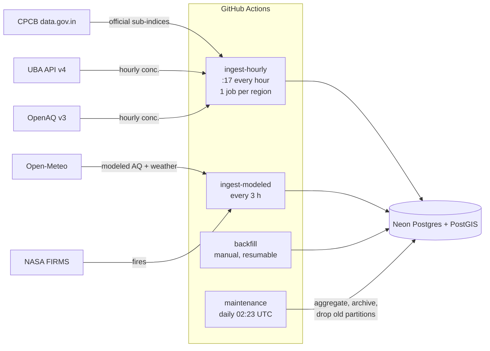

# Phase 3: Database and ingestion

## Data flow



## Source roles per region

| Region | Hourly concentrations (source of truth) | Official index | Modeled | History |
|---|---|---|---|---|
| Tamil Nadu, Kerala | OpenAQ (CPCB monitors), true hourly with coverage ≥ 75% | CPCB data.gov.in sub-indices → `official_aqi` | Open-Meteo, 1 point per district | OpenAQ hourly (90 d) + daily (years) |
| UAE | OpenAQ (12 low-cost AirGradient sensors) | none published openly | Open-Meteo incl. dust, 7 emirates + 11 grid points | OpenAQ |
| Germany | UBA v4 (419 stations) | UBA's own index is in the API, used for engine tests | Open-Meteo, 1 point per Land | UBA hourly + daily since 2016; EEA fills gaps |

### Why India's live concentrations do not come from CPCB

The data.gov.in feed's `min/avg/max_value` fields are **CPCB sub-index values, not concentrations**.
CO values of 25–47 would be impossible as mg/m³ (above 34 is already "Severe") and far too low as µg/m³,
but they are normal as sub-indices. The feed is stored as-is in `official_aqi` (shown as "Official CPCB index"
and compared with our engine's result) and never mixed into `readings`.

OpenAQ archives the same CPCB monitors as true hourly concentrations, but its India feed **stopped on
2026-10-18 08:30 UTC** (all 481 CPCB stations show the same last timestamp: an upstream outage). The hourly
job asks OpenAQ only for locations whose `datetimeLast` moved past our latest stored hour, and catches up
to 7 days back automatically when the feed resumes. Until then, India shows the official CPCB index (live)
and modeled concentrations (labelled), never invented values.

## Data-quality rules (all counted in `ingestion_runs.details.rejected_reasons`)

| Rule | Where | Why |
|---|---|---|
| pydantic validation: UTC, hour-aligned (minute 0 or 30), 0 ≤ value ≤ physical max, coords not (0, 0) | `models.py` | Bad rows are counted, not crashed on |
| OpenAQ hour dropped if coverage < 75% | `openaq.py` | Same completeness bar as most AQI standards |
| CPCB CO labelled "ppb" with value < 20 is converted as mg/m³ | `openaq.py` | Observed: Manali CO "ppb" values of 0.22–0.5 are impossible as ppb |
| UBA and EEA timestamps are fixed CET (UTC+1) | `adapters/__init__.py` | UBA returns a 02:00 hour on the spring-forward day; EEA matches UBA at 0 offset (MAE 0.24) |
| Duplicate CPCB rows removed | `cpcb.py` | The feed repeats some rows verbatim |
| EEA `Validity` ∉ {1,2,3} or −999 placeholders dropped | `eea.py` | EEA files contain future placeholder hours |
| Source priority on conflicts: official 90 > EEA 80 > OpenAQ 70 > FIRMS 50 > model 10; nulls never erase values | `db.write_readings` | A model can never overwrite a measurement |

## Station identity

`stations` holds one row per physical location; `station_sources` maps each source's ID to it. A new source
record is linked to an existing station of the same kind within 250 m, or with the same normalised name
within 5 km (CPCB's and OpenAQ's coordinates for one monitor differ by ~150 m). Regions come from a
PostGIS lookup against admin boundaries, with the nearest area within 5 km accepted because simplified
coastlines cut off stations in Chennai and Dubai. A rectangle was not enough: the Tamil Nadu bounding box
contains Bengaluru.

## Retention

- `readings` and `weather` are partitioned **weekly**. The daily job drops partitions whose whole week is
  older than 90 days (`drop_old_partitions`), which frees space immediately. A bulk `DELETE` would leave
  dead tuples behind.
- Before dropping, hours inside festival windows (`events.py`: Deepavali, Bhogi, New Year's Eve, ±3 days)
  are copied to `readings_archive`, kept forever.
- `readings_daily` (by local calendar day) and `weather_daily` are kept forever. Days computed from our own
  hourly data (`n_hours` set) take precedence over source-provided daily values.

## Free-tier budget per run

| Job | Calls | Notes |
|---|---|---|
| hourly, Germany | UBA: 1 meta + 6 components | all 419 stations in 7 calls |
| hourly, TN / Kerala | CPCB 1–2 + OpenAQ 1 + sensors with new data | ~0 sensor calls while OpenAQ India is down |
| hourly, UAE | OpenAQ 1 + ~24 sensors | |
| modeled (every 3 h) | Open-Meteo 2 per region (≤ 50 points per call) | 86 points × 2 × 8 runs ≈ 1,400 weighted calls/day of 10,000 |
| FIRMS | 2 per region every 3 h | limit is 5,000 per 10 min |

German low-cost sensors (209 AirGradient devices in OpenAQ) are not polled. Fetching them hourly costs
~420 OpenAQ calls (one per sensor), ~23 minutes at the shared CI rate. UBA's official network already covers
Germany.

## Running it

```bash
export PYTHONPATH="ingestion/src;aqi-engine/src"     # or: pip install -e aqi-engine -e ingestion
python -m airatlas_ingest migrate
python -m airatlas_ingest boundaries                  # once; also creates modeled points
python -m airatlas_ingest hourly --region germany
python -m airatlas_ingest modeled --region uae
python -m airatlas_ingest maintenance
python -m airatlas_ingest backfill --region germany --source uba --kind daily --days 1095
python -m airatlas_ingest backfill-events --region tamil_nadu
python -m airatlas_ingest status
```

GitHub secrets needed: `DATABASE_URL` (pooled Neon string), `OPENAQ_API_KEY`, `FIRMS_MAP_KEY`,
`DATA_GOV_IN_API_KEY`.

## Bugs caught during the build

| Bug | Caught by | Fix |
|---|---|---|
| Station lookups consumed a generator twice, so unknown stations were silently not counted | `test_readings_merge_sensors_and_respect_source_priority` | materialise keys once (`db._resolve`) |
| Non-autocommit connection: a failing source would roll back earlier sources' writes in the same job | code review before first live run | `autocommit=True`; each write is its own `conn.transaction()` |
| Partition helpers resolved names via `search_path`, so a second schema reused `public`'s partitions | integration tests, once `public` held real data | migration 004 qualifies every name with the parent's schema |
| `drop_old_partitions` returned OIDs instead of names | first live `maintenance` run | migration 003 (applied migrations are never edited) |
| geoBoundaries spells "Tamil Nādu" with a macron | first live `boundaries` run | match names with diacritics stripped |
| Windows MAX_PATH: unnormalised `ingestion/../aqi-engine` imports failed | local test run | resolve the path in `conftest.py` |
